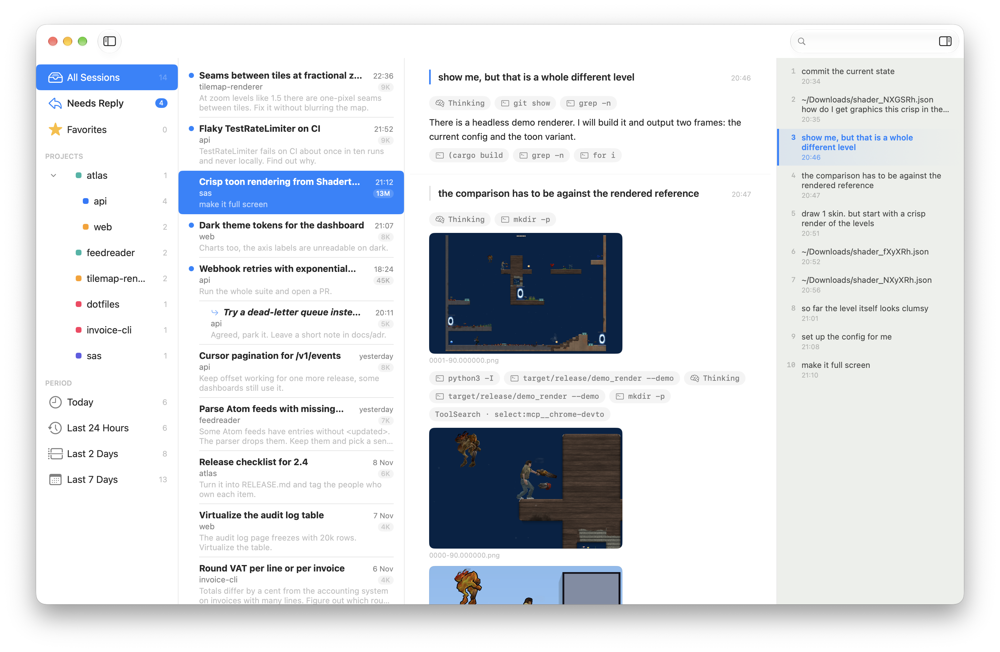
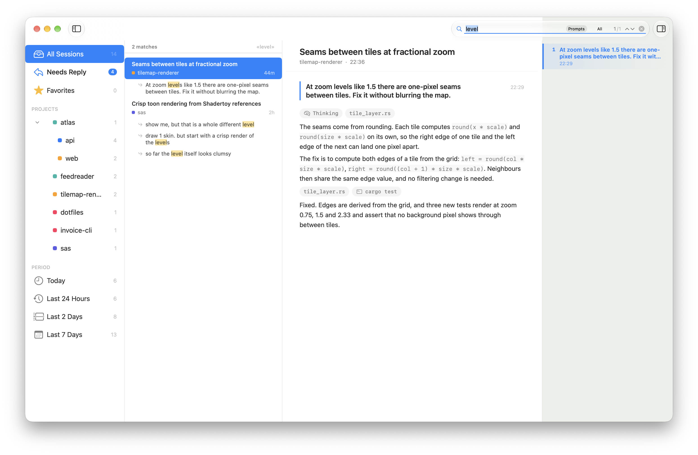
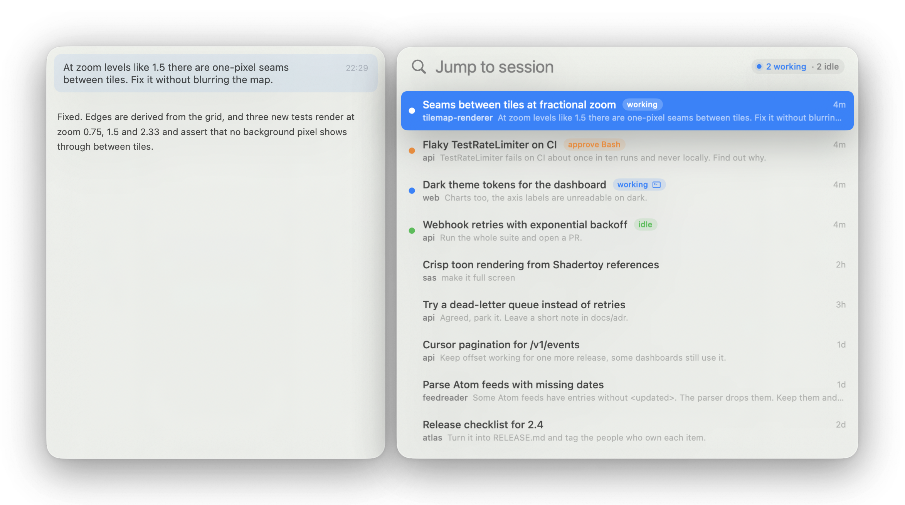

### Session Explorer (macOS)

A native SwiftUI app for browsing your Claude Code sessions. It reads the JSONL
files under `~/.claude/projects`, lets you search across all of them, and opens
any session back up in your terminal.

<br clear="left">



Search covers your prompts by default and shows the matching prompts under each
session; switch to All to search the full text of every transcript.



The jump palette (⌘K, or ⌃⌥Space from any app) finds a session by title,
project, or last prompt. With an empty query it lists the sessions Claude is
working in right now.



## Features

Browsing

- The sidebar holds quick filters (Needs Reply, Favorites, Hidden, time
  periods) and a project tree: nested directories become child nodes, and
  several projects can be checked at once.
- The session list is ordered by the time of your last prompt and shows a size
  badge per session. Sessions created with `/branch` are nested under the
  session they were branched from.
- Session titles come from `custom-title`, then `ai-title`, otherwise one is
  generated from the first prompt.
- The list and the open transcript update live as Claude Code writes to disk.

Transcript

- Adjacent messages from one side are merged into a single reply. Tool calls
  collapse into compact chips and expand on click, thinking blocks too.
- Images render inline, both the ones pasted into a prompt and the ones Claude
  read with a tool. Click one to open a lightbox that pages through every image
  in the session.
- The outline on the right lists your prompts with thumbnails of their images;
  click a prompt to jump to it.
- Rewound or edited prompts leave branches inside a session. Show the active
  branch only, switch between alternatives in place, or see all of them as a
  tree (View → Branches in Dialog).
- Brief mode (⌘E) drops tool output and thinking, leaving just the replies.
- A compaction summary is shown as a collapsed divider, and prompts queued
  while Claude was working appear as regular prompts.

Search and navigation

- Search (⌘F) requires every word to match; wrap a pattern in slashes
  (`/pattern/`) for a regex. Matches are highlighted, and ⌘G / ⌘⇧G step
  through them in the open transcript.
- The jump palette ranks sessions by title, project, session name, last prompt
  and id, and also understands a query typed in the wrong keyboard layout.
  Running Claude Code processes are marked as working or waiting. ↵ opens the
  session in the app, ⌘↵ in the terminal. The system-wide hotkey and
  start-at-login are switched on in Settings.
- Triage mode (⌘⇧T) walks through the sessions that wait for your reply, one
  at a time.

Getting sessions in and out

- Open in terminal (⌘↩) runs `claude --resume <id>` in the project directory.
  Pick Ghostty, Terminal.app, or iTerm2 in Settings; the launch command is
  configurable and runs through your login shell.
- Copy one or several sessions with their content (⌘C), or only the replies
  since a given date (⌘⌥C).
- Export as PDF (⌘⇧P) or Markdown: a styled transcript with prompts, tool
  calls, and inline images. Works on a multi-selection of sessions.
- Share via link (⌘⇧S): upload a set of sessions to the web viewer and get a
  public URL. A link stays up until you delete it from the app.
- Edit user prompts in place: hover a prompt and click the pencil (to fix a
  typo before sharing, for example). The change is written back into the
  session jsonl.
- Export the raw jsonl as `.jsonl.gz`, and open any `.jsonl` / `.jsonl.gz`
  from disk (⌘O). It shows up pinned at the top of the list, wherever the file
  lives.

## Build

Needs macOS 26, Xcode, and [XcodeGen](https://github.com/yonaskolb/XcodeGen).

```sh
xcodegen generate
xcodebuild -project SessionExplorer.xcodeproj -scheme SessionExplorer -configuration Release build
# or open SessionExplorer.xcodeproj in Xcode and hit Run
```

The app runs unsandboxed: it reads `~/.claude` (or `$CLAUDE_CONFIG_DIR`) and
uses Apple Events to drive the terminal. On the first "Open in Terminal" allow
Automation for your terminal (System Settings → Privacy → Automation).

## Keyboard shortcuts

The same list is available in the app under Help → Keyboard Shortcuts (⌘⇧/).

| Key | Action |
|---|---|
| `⌘K` | jump palette |
| `⌃⌥Space` | jump palette from any app |
| `⌘↑` / `⌘↓` | previous / next session |
| `↩` | move focus from the list into the transcript |
| `↑` / `↓` | navigate replies once the transcript is focused |
| `[` / `]` (or `⌘[` / `⌘]`) | previous / next reply |
| `⌃⌘[` / `⌃⌘]` (or `Home` / `End`) | first / last reply |
| `⌘F` | focus search |
| `⌘G` / `⌘⇧G` | next / previous match |
| `Esc` | clear search |
| `⌘↩` | open session in terminal |
| `⌘O` | open a `.jsonl` / `.jsonl.gz` session file |
| `⌘C` | copy session(s) with content |
| `⌘⌥C` | copy replies since a date |
| `⌘⇧C` | copy resume command |
| `⌘⇧P` | export as PDF |
| `⌘⇧S` | share via link |
| `⌘⇧R` | reveal in Finder |
| `⌘D` | toggle favorite |
| `⌘⌫` | hide session · `⌃Z` undo hide |
| `⌘E` | brief mode |
| `⌘B` | show / hide sidebar |
| `⌘⇧L` | show / hide session list |
| `⌘⇧B` | show / hide outline |
| `⌘+` / `⌘-` / `⌘0` | zoom text in / out / reset |
| `⌘⇧=` / `⌘⇧-` | more / less spacing between messages |
| `⌘⇧T` | triage mode (reply to all in turn) |
| `⌘↩` / `⌥X` / `⌥→` | in triage: reply and continue / no reply needed / skip |
| `⌘⌃F` | toggle full screen |

## Web viewer and the share skill

`web/` is the viewer behind shared links: a static page plus a Cloudflare
Worker that stores the uploaded sessions. `skills/share-session` is a Claude
Code skill that shares the current session from inside Claude Code:

```sh
npx skills add a-kuz/claude-session-explorer
```

## Layout

- `Sources/Core/` — reading and parsing JSONL (`Loader`), the metadata cache
  (`Store`), text extraction (`Content`), search (`Search`, `PromptIndex`),
  titles (`AutoTitle`), the jump palette and running processes (`Palette`,
  `LiveSessions`), opening a terminal (`OpenSession`), export and sharing
  (`ExportPDF`, `ShareService`), and the FSEvents watcher (`FolderWatcher`).
- `Sources/Models/` — domain types and reply assembly.
- `Sources/AppModel.swift` — state, filters, search, and navigation.
- `Sources/Views/` — the SwiftUI views.
- `web/` — the web viewer and its Worker.
- `skills/` — the `share-session` skill.
